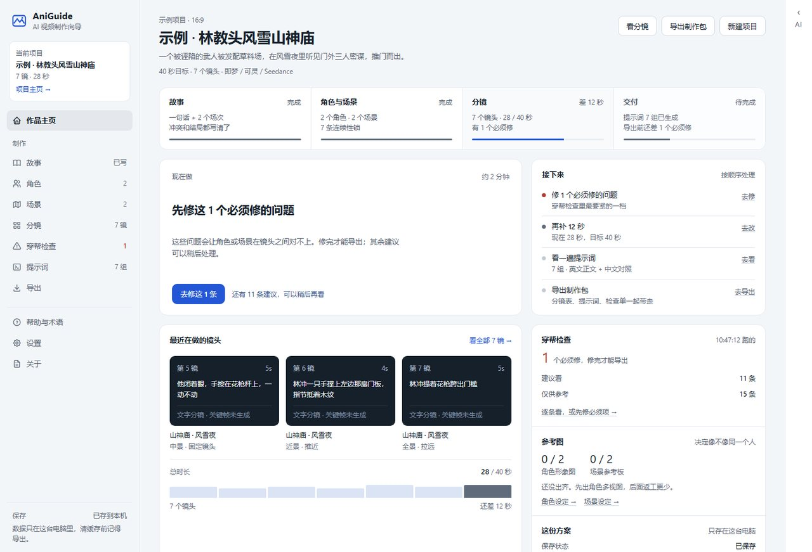
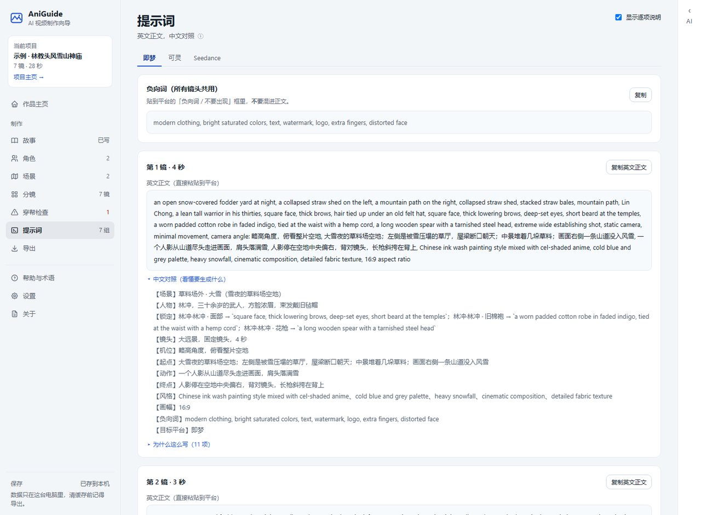
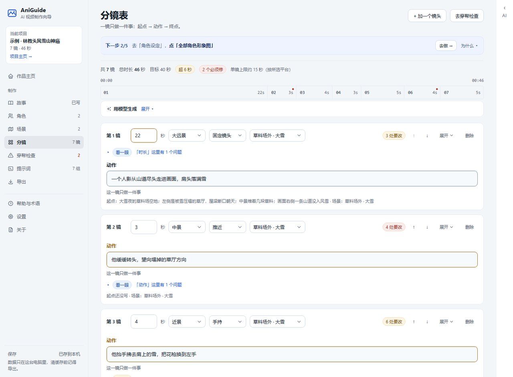
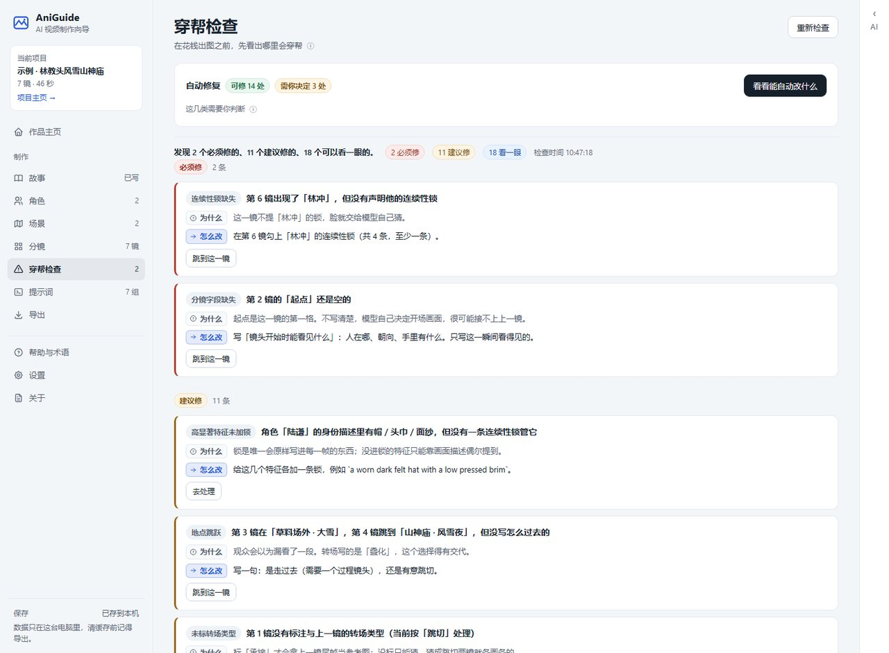

# AniGuide · AI 动漫视频创作向导

免注册的纯网页工具。不生成视频，也不做剪辑。

它交付一份能直接开拍的方案：分镜表、角色与场景设定卡、多平台提示词、一份穿帮检查单。拿到之后，你去即梦、可灵、Seedance 这些平台执行。



---

# 功能

跟着侧栏从上往下走，就是完整的制作顺序。

| 页面 | 给你什么 |
|---|---|
| **作品主页** | 四步进度、下一步做什么、最近的镜头、检查与参考图状态 |
| **故事** | 问答式向导，一次只问一件事；写正文、拆场次、定画幅与时长 |
| **角色** | 身份、变体、连续性锁三层；可出全身多视图与头部特写 |
| **场景** | 空间结构、固定元素、主光方向、主色调；可出空场景参考板 |
| **分镜** | 每镜只答三件事：起点、一个动作、终点。另有景别、机位、运镜、时长、台词、声音、情绪、衔接 |
| **穿帮检查** | 26 条规则，分必须修、建议修、看一眼。问题直接标在分镜页的对应字段上 |
| **提示词** | 英文正文加中文对照，逐项说明；支持即梦、可灵、Seedance、Runway、Sora、Veo |
| **导出** | 一个压缩包：分镜表、设定卡、各平台提示词、检查单、进度表、图片提示词；有图时附图包 |

每个镜头出三张图：首帧定构图、动作关键帧取动作顶点、尾帧接下一镜。

**改稿**用右侧对话栏。说人话就行：把结局改成主角牺牲、第 3 镜太平了、加一个四十来岁的反派、删掉多余的第 5 镜。它给的是可执行的改动，改字段、新建角色或镜头、删除对象，你确认后才生效。

**工具页**：43 条分镜术语，只写判断依据不背定义；8 家厂商的 Key；三套外观。





---

# 核心亮点

## 一、新手引导

新手卡住的不是软件操作，是不知道现在该干什么。引导分三层。

**第一层：向导一次只问一件事。**

写故事拆成主题、情绪、结局停在哪个画面。每个问题旁边能点开看为什么要问。新手缺的是判断依据，不是定义。

**第二层：每页顶部一行「下一步」。**

只占一行，不挡操作。想看完整五步、当前进度、做完会看到什么，点右边展开。向导最后一页那张清单只写去哪里、做什么，每步配一个跳转按钮。

**第三层：作品主页说的是眼下最该做的那件事。**

不是固定的步骤图，是按当前状态算出来的：

| 你的状态 | 它会说 |
|---|---|
| 还没打开项目 | 先打开一个项目 |
| 故事是空的 | 先把故事写下来 |
| 有故事、没角色 | 先定下人物和场景 |
| 有设定、没分镜 | 把故事拆成分镜 |
| 检查有 3 个必须修 | 先修这 3 个必须修的问题 |
| 时长超了 8 秒 | 先减掉 8 秒 |
| 都齐了 | 导出制作包 |

## 二、一致性审查

跨镜穿帮是 AI 动漫最劝退的问题：角色变脸、衣服变色、场景换样。两个手段压住它。

### 手段一：五道一致性防线

| 层 | 做法 | 管什么 |
|---|---|---|
| **连续性锁** | 你登记的英文短语原样写进相关每一帧 | 服装、道具、场地固定物 |
| **角色形象图** | 全身多视图与头部特写各出一张，按景别挑一张当参考图 | 脸和体型说不清，只能靠图 |
| **本镜首帧** | 后两帧拿它当构图锚点 | 这一镜怎么取景，形象图锁不住 |
| **上一镜尾帧** | 仅在转场标「承接」时用作跨镜锚点 | 两镜的空间、光线、主体位置接不接得住 |
| **场景参考板** | 空镜与广角用它固定空间 | 同一个地方不像两个地方 |

出图顺序也按这条链走：先出角色形象图与场景参考板，再按镜头顺序，每镜首帧、关键帧、尾帧连着出。

两个角色同框的承接镜要 4 张参考图，默认模型只收 3 张，装不下。这时按景别决定先丢谁：全景先丢形象图，中景以里先丢场景板。丢掉的会写进生成结果，不静默。

### 手段二：26 条规则

查的是文本约束，也就是该一致的地方有没有写下来。它不承诺零穿帮，只让大部分穿帮在花钱出图之前暴露。

| 规则 | 它在说什么 |
|---|---|
| 相邻镜同景别 | 连着两个中景，观众觉得没剪 |
| 画面描述里的代词 | 提示词是给模型看的文字，它不知道「他」是谁，两人同框一定错位 |
| 抽象情绪词 | 「难过」指导不了画面，模型只能随便挑一种 |
| 单镜位移过大 | 几秒内跨越大段距离，中间那段最难补得自然 |
| 场景光线冲突 | 场景卡定的是傍晚暖光，这一镜写成正午顶光 |
| 场景空间结构缺失 | 门开在哪、什么在左没写下来，每镜都在重新猜 |

每条说清三件事：哪里错、为什么错、怎么改。不甩错误码。「为什么」和「怎么改」各带图标与底色标签，左右两列对齐，怎么改用强调色。

标记长在字段上。每镜标题行右边有「N 处要改」，点它展开这一镜；出问题的字段下面各有自己那一行，点哪行只展开哪行。贴不到字段上的收在「这一镜还有 N 处」，不会因为放不下就不显示。



### 自动修复：只提议，不直接改

只提议能机械确定的修改：补锁、补字段、统一时长。需要审美判断的一律不碰。光线冲突是改场景卡还是改这一镜，只有你知道。

每条带修改前后对照，逐条勾选确认后才落盘，能撤销。

---

# 如何开始

## 第 0 步：把项目拿到手

```bash
git clone https://github.com/exiell/ai-video.git aniguide
cd aniguide
```

仓库名是 `ai-video`，项目叫 AniGuide，这里用 `aniguide` 作本地目录名，不加也行。没装 git 就在仓库页面点 Code → Download ZIP。

## 第 1 步：一键启动

Windows 双击 `start.cmd`。macOS / Linux：

```bash
chmod +x start.sh    # 只需一次
./start.sh
```

第一次约 1 分钟装依赖，之后很快，装完自动开浏览器。

<details>
<summary>不想用一键脚本？点开看手动步骤</summary>

需要 Node.js 20+（没有就去 https://nodejs.org/zh-cn 装 LTS 版）。

```bash
node -v            # 确认 >= 20
corepack enable    # 如果 pnpm 不是命令
pnpm install
pnpm dev           # → http://localhost:5173/
```

</details>

脚本替你处理几件容易卡住的事：没装 Node 就给出下载地址；版本太低就说清需要 20 或更高；没有 pnpm 就自动装；依赖装过就跳过；端口被占用就提示可能已经开着一个；项目在同步盘里就提醒可能报 EBUSY。

## 上手顺序

1. 先点「打开示例项目」。不用配任何 Key 就能看到一份完整产出。
2. 打开 `/cors-check.html`（设置页也有入口），确认网络能直连厂商。跨域是浏览器的策略，命令行能通不代表浏览器能通。
3. 设置里按厂商填 Key，点「测试连接」。它会当场说清是跨域被拦、密钥无效、余额不足，还是模型名不对。
4. 按侧栏走一遍：故事 → 角色与场景 → 分镜 → 穿帮检查 → 提示词 → 导出。
5. 卡住就用右侧「问 AI」。

想换外观：设置 → 外观，三套里挑一个，选择会记住。

## 常用命令

```bash
./start.sh        # 一键启动（Windows 双击 start.cmd）
pnpm dev          # 开发服务器
pnpm test         # 跑测试
pnpm build        # 生产构建 → dist/
pnpm typecheck    # 只做类型检查
pnpm check:copy   # 界面文案与字号检查

# 一次性诊断脚本（需要联网）
node scripts/provider-probe.mjs   # 核验各厂商能否从浏览器直连
```

---

# 其他

## 它明确不做

一键成片、视频生成、配音字幕音乐、剪辑、自动发布、账号系统、云端存储、训练模型。

上面每一条都能做，但做了就不是新手工具了。

## 8 个厂商开箱可用

已实测确认浏览器可直连：DeepSeek、阿里云百炼（通义千问）、智谱 GLM、月之暗面 Kimi、MiniMax、阶跃星辰、硅基流动、百度千帆。

Key 是厂商级的，同一家的对话与出图共用一个，只填一次。每家都写明直连证据，没实测过的如实标「未核实」。

出图请求体按字段映射构造。各家字段名不同，加一家只改数据不改代码。

## 你的数据在哪

所有数据在浏览器的 IndexedDB 里。请求只在你的浏览器和厂商之间发生，中间没有服务器。

API Key 默认存在这台电脑上，下次打开不用重填。电脑是共用的就勾「不保存到本机」，Key 只存在当前会话，关掉浏览器即失效。不论勾不勾，Key 都不会离开你的浏览器。

阿里云返回的图片链接 24 小时后失效。AniGuide 在拿到图当下就下载留存成 base64，你看到的每一张图都真正属于你。

## 技术栈

Vite 6、React 19、TypeScript strict、Zustand、Dexie、Zod、fflate。纯静态产物，可以直接丢到任意静态托管。

没有 UI 组件库，样式自己写，为了控制体积和保持观感一致。三套外观靠 `data-theme` 切换 CSS 变量，不换组件。

图标来自 [Tabler Icons](https://github.com/tabler/tabler-icons)（MIT），厂商标识来自 [Simple Icons](https://github.com/simple-icons/simple-icons)（CC0-1.0），蓝图外观的网格底纹参考 [css3patterns](https://github.com/LeaVerou/css3patterns)（MIT）。三处都是按许可引入的原始 SVG，不引入图标库运行时。

所有模型调用必须经过唯一入口 `ModelGateway`，业务代码不允许直接 fetch 厂商接口。将来要接代理，只改一处配置。

目录分工见 [CONTRIBUTING.md](./CONTRIBUTING.md)。

## 项目状态

`tsc --noEmit` 0 错误，单元测试全过，生产构建 exit 0。主包约 634 KB，gzip 约 207 KB。

尚未做：真实样本外链、部署上线。

逐版本变更见 [CHANGELOG.md](./CHANGELOG.md)，记的是你能感知到的变化。

## 参与贡献

报问题或提建议走 [Issue](https://github.com/exiell/ai-video/issues/new/choose)。改代码就 Fork、开分支、提 PR，流程与审阅标准见 [CONTRIBUTING.md](./CONTRIBUTING.md)。

提交前跑 `pnpm test` 和 `pnpm typecheck`，两条都过才会被合并。

## 开源许可

MIT License，见 [LICENSE](./LICENSE)。

第三方资产按各自许可署名，完整原文见 [THIRD-PARTY-NOTICES.md](./THIRD-PARTY-NOTICES.md)。

| 项目 | 许可 | 复用内容 |
|---|---|---|
| [zenstory-ai/drama-skills](https://github.com/zenstory-ai/drama-skills) | MIT | 一致性三层机制、冻结关键帧写法、引用校验的报错范式 |
| [jijiutong/ai-visual-director](https://github.com/jijiutong/ai-visual-director) | MIT | 影视知识库、多平台提示词格式规范、数据模型骨架 |
| [BaYue-SYJ/shuixian-prompts](https://github.com/BaYue-SYJ/shuixian-prompts) | Attribution Required v1.0 | 中文 AI 绘画提示词库（可插拔数据源，未内置） |

本项目基于「水仙的AI提示词」（https://github.com/BaYue-SYJ/shuixian-prompts）二次开发。该许可允许非商业用途自由使用，商业用途需先取得作者书面授权。

仓库内提示词原文与图片，版权归各自原作者。本项目与上述三个项目的作者无隶属或背书关系。

---

*AniGuide 是一个创作者工具，不生成内容。你用它产出的东西，版权归你。*
