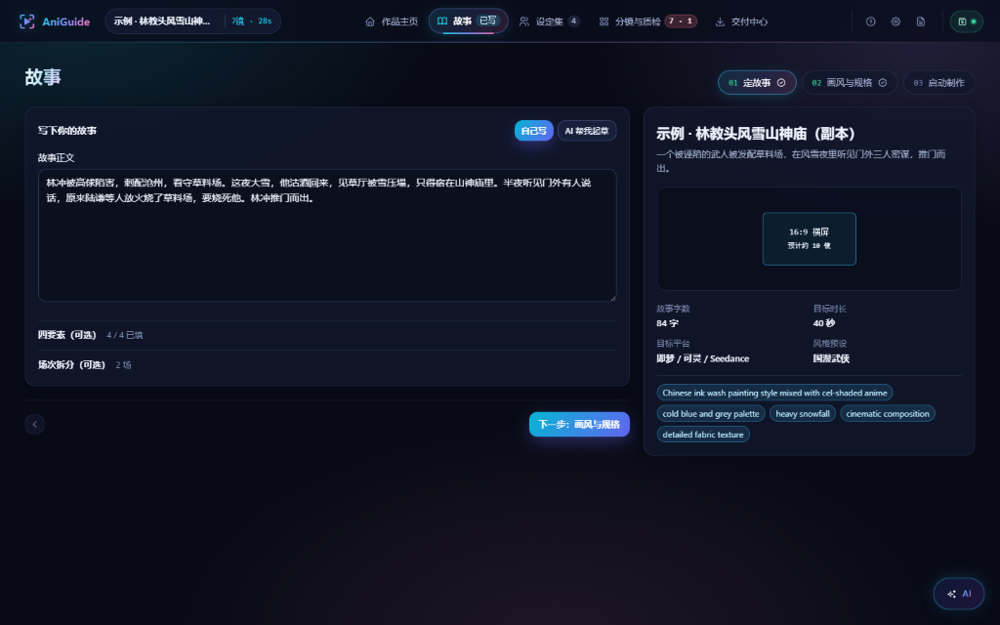
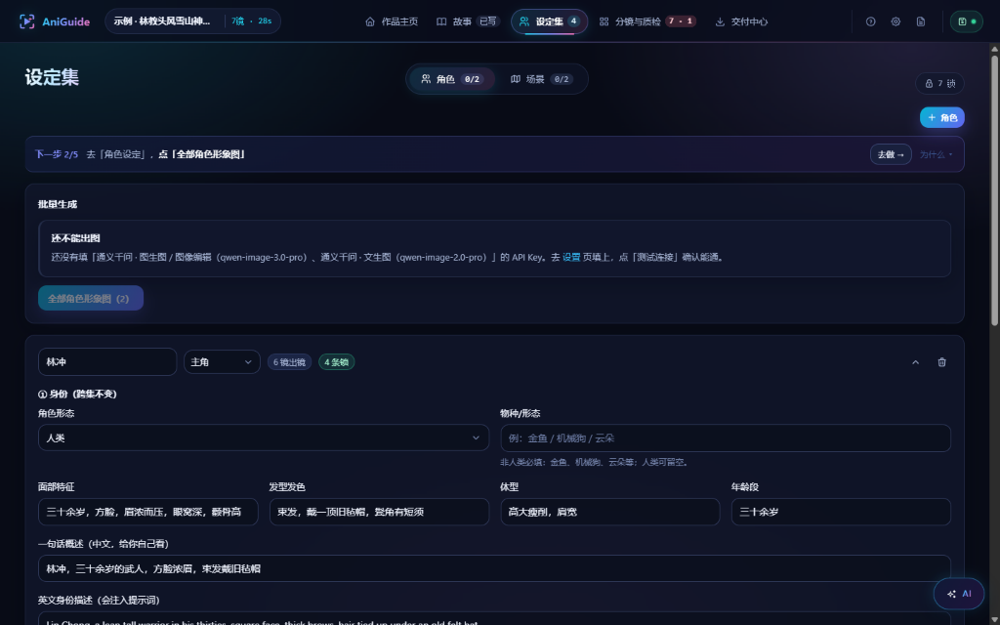
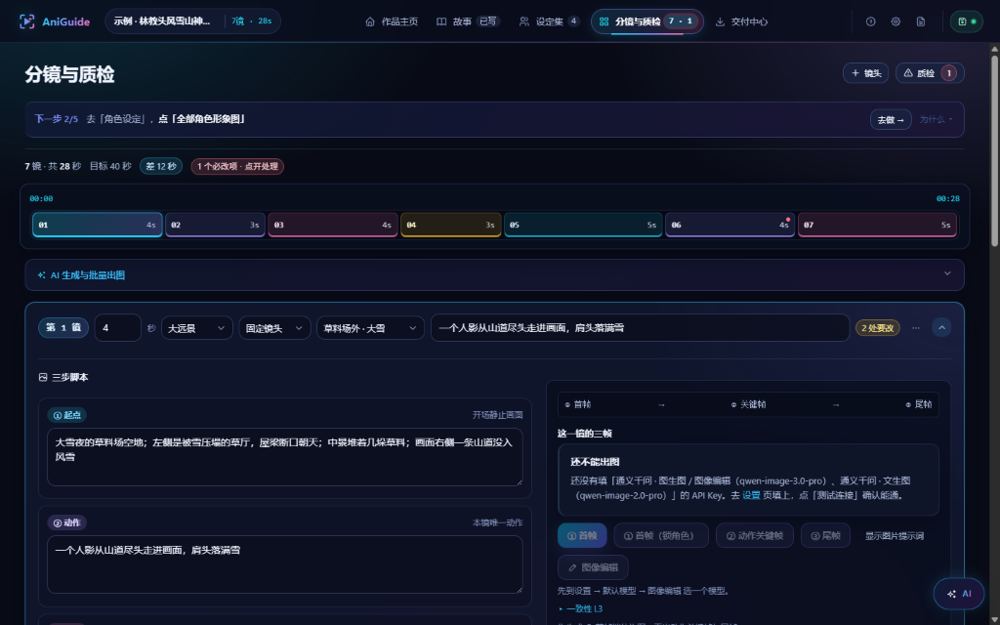
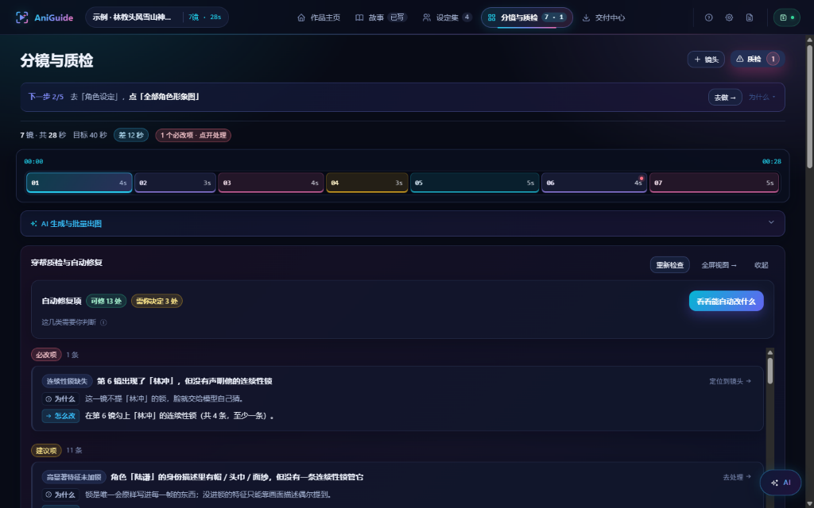
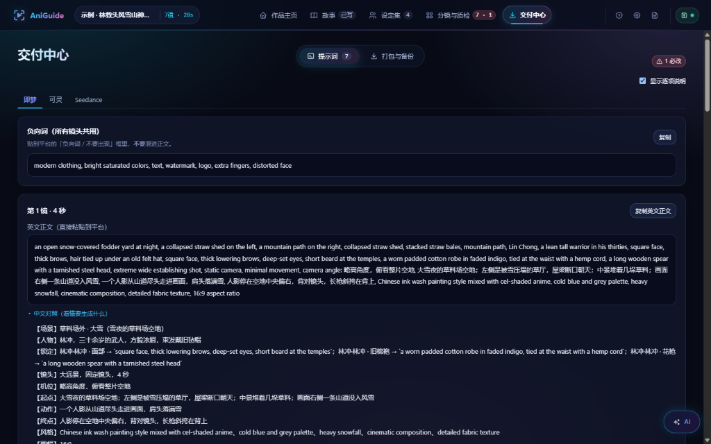
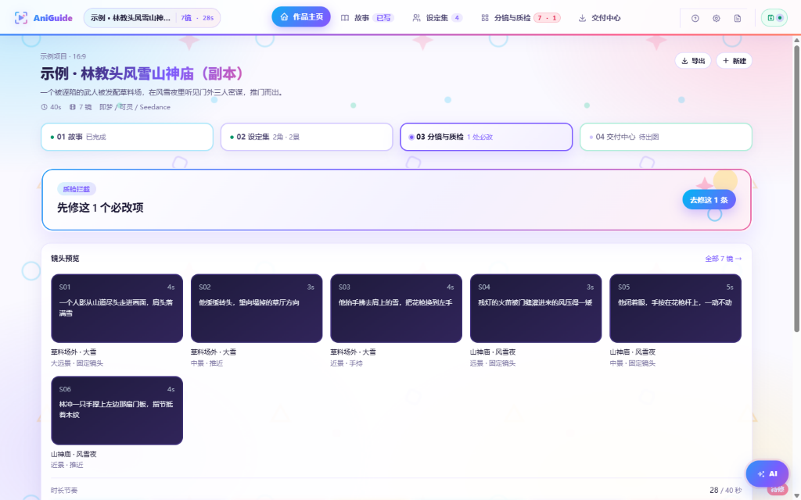
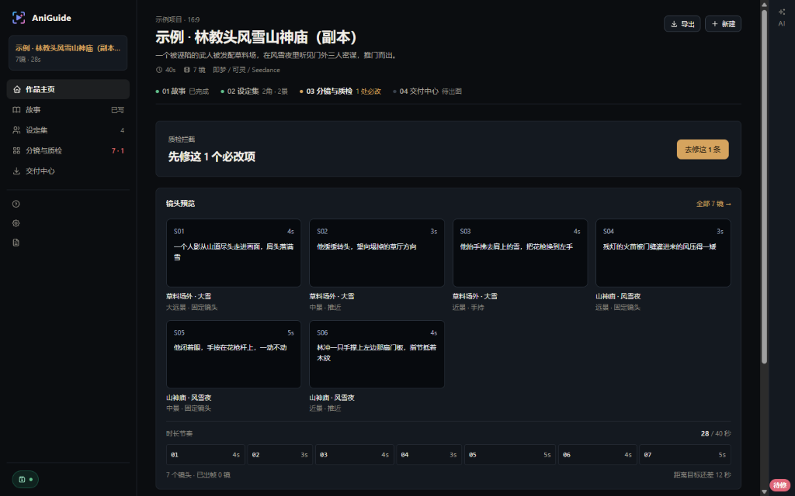

<div align="center">
  
  <h1>AniGuide · AI 动漫视频创作向导</h1>
  <p>
    <strong>把「我想做个动漫视频」变成一份可直接开拍的前期制作方案</strong><br />
    免注册 · 零后端 · 数据纯本机 · 支持 <b>Windows 桌面客户端</b> 与 <b>纯静态网页版</b> 双端运行
  </p>
  <p>
    <a href="https://github.com/exiell/ai-video/releases/latest"><strong>⬇️ 下载 Windows 安装包（v0.1.0）</strong></a>
    &nbsp;·&nbsp;
    <a href="#功能一览5-阶段线性创作流">功能一览</a>
    &nbsp;·&nbsp;
    <a href="#外观主题实机预览">外观主题</a>
    &nbsp;·&nbsp;
    <a href="#如何开始">快速开始</a>
    &nbsp;·&nbsp;
    <a href="./CHANGELOG.md">更新日志</a>
  </p>
</div>

<p align="center">
  
</p>

AniGuide 交付一份能直接开拍的前期方案：**动漫分镜表、角色与场景设定卡、多平台提示词、26 项穿帮检查单，以及分镜三帧与 5 秒本地预览视频**。拿到方案后，你可以直接去即梦、可灵、Seedance 等平台生成成片，也可以在客户端内直连 8 家云端模型或本机自托管模型完成出图、改图与预览。

---

## 核心亮点

- **独立桌面 App 体验（Electron 发行版）**：原生无边框一体化标题栏（随 5 套主题实时同步配色）、桌面级防误选工作台手感与细滚动条、全局快捷键（`Ctrl+S` / `Ctrl+,` / `Ctrl+\` / `Ctrl+E`）、系统原生「另存为」与一键打开导出目录。
- **彻底告别浏览器跨域（CORS）**：桌面客户端经主进程直连 8 家云端厂商与本地自托管模型，无需配置转发代理；API Key 支持系统凭据加密存储（Windows DPAPI / macOS Keychain），数据纯本机留存。
- **唯一「下一步」新手引导**：作品主页自动根据当前项目健康度算出最急的一项任务（写故事 → 补设定 → 拆镜头 → 修穿帮 → 出参考图 → 出三帧 → 交付导出），消除新手面对空白表格的迷茫。
- **五道一致性防线 + 26 条防穿帮质检**：从「连续性锁 → 角色形象图 → 本镜首帧 → 上一镜尾帧 → 场景参考板」五层锁死人物与场景，出图前用 26 条规则拦截代词错位、光线冲突、景别雷同等常见穿帮，支持一键定位与「只提议、经确认才落盘」的自动修复。
- **悬浮 AI 副导演**：常驻右下角跨页保留对话，直接用大白话改剧情、加角色、调分镜，输出字段级 diff 提议，确认后生效且支持撤销。

---

## 功能一览（5 阶段线性创作流）

主导航收拢为 **5 个清晰创作阶段**，跟着顶部制片通栏从左往右走，就是完整的动漫前期制作流程（原有 `/characters`、`/scenes`、`/checks`、`/prompts`、`/export` 路由均保留兼容）：

### 1. 作品主页 · 制片总控台
未打开项目时突出「创建新项目」与「导入项目」（支持 `.zip` 完整包或 `项目数据.json`），并提供内置示例项目一键体验；打开项目后呈现四步进度条、**唯一行动卡**、镜头预览网格与连贯性健康度。

### 2. 故事 · 3 步聚焦立项与实时预览
一次只聚焦一件事（定故事 → 画风与规格 → 启动制作），右侧常驻立项预览卡，实时呈现画幅比例框、目标时长、预计镜数与画风标签；支持自己写或由 AI 起草。



### 3. 设定集 · 角色与场景防穿帮锚点
双 Tab 统一管理全片一致性资产：角色三层设定（身份 / 变体 / 连续性锁）与全身多视图/头部特写，场景固定元素/主光/主色调与空场景参考板，均支持基于已有图的「图像编辑」。



### 4. 分镜与质检 · 左文右图双栏 + 穿帮抽屉
顶部吸顶全彩时间轴一眼看清全片节奏；展开单镜采用**左文右图双栏**——左侧按「① 起点 → ② 动作 → ③ 终点」填写脚本与防穿帮锚点，右侧按序生成三帧（首帧、动作关键帧、尾帧）与 5 秒预览视频。



点击右上角「质检」随时唤出**穿帮质检抽屉**，26 条规则逐条写明「哪里错、为什么错、怎么改」，点击任意问题立即定位并展开对应镜头，修完后红点实时消失。



### 5. 交付中心 · 多平台提示词与打包备份
双 Tab 整合多平台英文正文 / 中文对照提示词（即梦、可灵、Seedance 等）与 `.zip` 完整打包导出；桌面端支持系统原生「另存为」与一键打开所在文件夹，导出的 `.zip` 或 `项目数据.json` 可随时无损回导。



---

## 外观主题实机预览

在「设置 → 外观」中随时切换，选择自动保存在本机；桌面端标题栏控件色会随主题实时同步。所有主题共用完整功能与数据：

| 棱镜霓虹（默认 · 深色顶栏） | 彩绘棱镜（明亮 · 糖果流光） | 暗房（经典三栏 · 夜间护眼） |
| :---: | :---: | :---: |
|  |  |  |
| 深靛星空底、多色语义流光、顶部制片通栏 + 悬浮 AI 副导演 | 明亮奶油白底、彩虹流光、漂浮波普几何图形与圆润字体 | 近黑底、黄铜强调、经典三栏布局，夜间长时间看画面不刺眼 |

> 另内置 **工作台**（冷灰蓝浅色三栏，白天阅读清晰）与 **蓝图**（冷灰坐标纸网格 + 衬线标题，分镜档案质感）两套经典三栏主题。

---

## 五道一致性防线与 26 条穿帮规则

跨镜穿帮（角色变脸、衣服变色、场景换样）是 AI 动漫最劝退的问题，AniGuide 用两套机制协同压住它：

| 层 | 做法 | 解决什么问题 |
|---|---|---|
| **① 连续性锁** | 登记的英文短语原样写入相关每一帧 | 锁死服装、道具、场地固定物 |
| **② 角色形象图** | 全身多视图与头部特写各出一张，按景别自动选参考图 | 锁死脸型与体型（纯文字说不清的部分） |
| **③ 本镜首帧** | 动作关键帧与尾帧以本镜首帧为构图锚点 | 锁死单镜内机位与取景 |
| **④ 上一镜尾帧** | 仅在转场标「承接」时作为跨镜锚点 | 保证相邻两镜的空间、光线与主体位置衔接 |
| **⑤ 场景参考板** | 空镜与广角用空场景板固定空间结构 | 避免同一个场地换镜后变成两个地方 |

当单镜所需参考图超过所选模型上限（如部分云端/改图模型上限 3 张，本地 FLUX.3 上限 10 张）时，系统按景别自动降级（全景先舍形象图、中景以内先舍场景板）并在生成结果中如实写明，绝不静默丢图。

---

## 支持的模型与自托管接入

- **8 家云端厂商开箱可用**：DeepSeek、阿里云百炼（通义千问）、智谱 GLM、月之暗面 Kimi、MiniMax、阶跃星辰、硅基流动、百度千帆。Key 为厂商级，同一家对话与出图共用一个。
- **可选自定义 / 本地自托管模型**：在「设置 → 自定义接入」可接任意 OpenAI 兼容服务（Ollama、LM Studio、vLLM / vLLM-Omni 等），并在「自托管 / 本地模型快捷模板（高级）」折叠区内置了常用本地文字、生图（FLUX.3）、改图（Qwen-Image-Edit-2511）与 5 秒预览视频（SkyReels-V3）预填模板（端口与模型名均可按实际服务修改）。

---

## 如何开始

### 方式一：下载 Windows 桌面安装版（推荐）

1. 前往 [GitHub Releases](https://github.com/exiell/ai-video/releases/latest) 下载最新 `AniGuide-Setup-0.1.0.exe`。
2. 双击安装（因未购置商业代码签名证书，首次运行若弹出 Windows SmartScreen 提示，点击「更多信息 → 仍要运行」并在管理员授权弹窗点「是」即可）。
3. 启动后即可免跨域直连各家模型；若想先体验完整功能，可在作品主页直接点「打开示例项目」。

### 方式二：从源码运行（网页版 / 桌面端开发与打包）

```bash
git clone https://github.com/exiell/ai-video.git aniguide
cd aniguide
```

Windows 直接双击 `start.cmd`；macOS / Linux 运行 `./start.sh`（自动检测 Node.js 20+ 与 pnpm 并启动网页版）。

<details>
<summary>手动命令与桌面端打包命令（点击展开）</summary>

需要 Node.js 20+ 运行开发服务器，运行测试需要 Node.js 22.22+（`jsdom@30` 要求）。

```bash
pnpm install

# 网页版开发与构建
pnpm dev              # 启动网页开发服务器 → http://localhost:5173/
pnpm build            # 网页静态生产构建 → dist/

# Electron 桌面端构建与打包
pnpm desktop:build    # 编译渲染端 + Electron 主进程/预加载脚本（无 sourcemap）
pnpm desktop:pack     # 生成免安装目录包 → dist-release/win-unpacked/
pnpm desktop:dist     # 生成 Windows NSIS 正式安装程序 → dist-release/

# 质量门禁
pnpm test:local       # 全量单元测试
pnpm typecheck        # TypeScript 严格类型检查
pnpm check:copy       # 界面文案与字号规范检查
```

> 提示：若源码目录位于 OneDrive 同步盘内，建议将免安装目录包复制到非 OneDrive 本地路径运行，或直接使用正式安装程序安装到本地磁盘。

</details>

---

## 边界说明与数据安全

- **明确不做**：一键成片、长视频多镜剪辑拼接、配音/字幕/配乐、自动发布、服务端账号系统、云端持久化存储、模型训练（分镜内仅提供单镜 5 秒预览视频）。
- **数据完全归你**：所有项目数据、base64 图片与预览视频均保存在本机 IndexedDB 中（桌面端独立存放于系统应用数据目录，不随浏览器清缓存丢失；仍建议在交付中心定期导出 `.zip` 备份）。
- **无中间服务器**：不配自定义代理时，网络请求仅在你的客户端与所选模型厂商之间发生。

---

## 技术栈与项目状态

- **技术栈**：Electron 45 + Vite 6 + React 19 + TypeScript (`strict` + `noUncheckedIndexedAccess`) + Zustand 5 + Dexie 4 + Zod 4 + fflate；零第三方 UI 组件库，纯手写 `data-theme` 样式系统，所有模型请求收口于唯一入口 `ModelGateway`。
- **当前状态（2026-11-24）**：
  - ✅ 已发布 **Electron Windows 桌面安装版 `v0.1.0`**（免 CORS 直连、原生标题栏 5 主题同步、原生另存为导出、`safeStorage` 密钥加密、全新品牌与安装图标）；
  - ✅ 已完成 5 阶段线性主导航、26 项穿帮检查抽屉、自动修复、5 套外观主题与 `.zip` / `项目数据.json` 完整回导；
  - 🔜 后续计划：macOS `.dmg` 正式构建与自动更新检查、旧版三套经典外观在 5 阶段页面下的细节精修、真实外部示例链接补全。

逐版本变更见 [CHANGELOG.md](./CHANGELOG.md)，目录分工与贡献流程见 [CONTRIBUTING.md](./CONTRIBUTING.md)，问题反馈请提 [Issue](https://github.com/exiell/ai-video/issues/new/choose)。

---

## 开源许可与第三方署名

本项目采用 MIT License，详见 [LICENSE](./LICENSE)。第三方资产按各自许可署名，完整原文见 [THIRD-PARTY-NOTICES.md](./THIRD-PARTY-NOTICES.md)：

| 项目 | 许可 | 复用内容 |
|---|---|---|
| [zenstory-ai/drama-skills](https://github.com/zenstory-ai/drama-skills) | MIT | 一致性三层机制、冻结关键帧写法、引用校验的报错范式 |
| [jijiutong/ai-visual-director](https://github.com/jijiutong/ai-visual-director) | MIT | 影视知识库、多平台提示词格式规范、数据模型骨架 |
| [BaYue-SYJ/shuixian-prompts](https://github.com/BaYue-SYJ/shuixian-prompts) | Attribution Required v1.0 | 中文 AI 绘画提示词库（可插拔数据源，未内置） |

界面图标与底纹素材分别按许可引入自 [Tabler Icons](https://github.com/tabler/tabler-icons)（MIT）、[Simple Icons](https://github.com/simple-icons/simple-icons)（CC0-1.0）与 [css3patterns](https://github.com/LeaVerou/css3patterns)（MIT）。

本项目基于「水仙的AI提示词」（https://github.com/BaYue-SYJ/shuixian-prompts）二次开发。该许可允许非商业用途自由使用，商业用途需先取得原作者书面授权；仓库内提示词原文与图片版权归各自原作者，本项目与上述项目作者无隶属或背书关系。

---

*AniGuide 是一个创作者工具，不占有你的作品。你用它产出的故事、设定与分镜方案，版权归你。*
