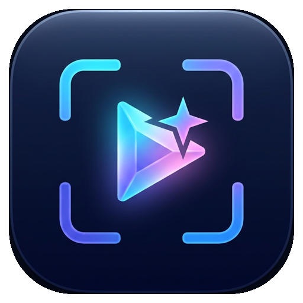
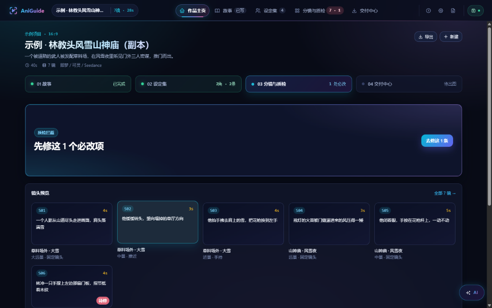

<div align="center">
  
  <h1>AniGuide · AI 动漫视频创作向导</h1>
  <p>
    <strong>把「我想做个 AI 视频」变成一份可直接开拍、可进剪辑软件的前期制作方案</strong><br />
    免注册 · 零后端 · 数据纯本机 · 支持 <b>Windows 桌面客户端</b> 与 <b>纯静态网页版</b> 双端运行
  </p>
  <p>
    <a href="https://github.com/exiell/ai-video/releases/latest"><strong>⬇️ 下载 Windows 安装包（v0.2.0）</strong></a>
    &nbsp;·&nbsp;
    <a href="#功能一览5-阶段线性创作流">功能一览</a>
    &nbsp;·&nbsp;
    <a href="#外观主题实机预览">外观主题</a>
    &nbsp;·&nbsp;
    <a href="#如何开始">快速开始</a>
    &nbsp;·&nbsp;
    <a href="./CHANGELOG.md">更新日志</a>
  </p>
</div>

<p align="center">
  
</p>

AniGuide 交付一套能直接开拍并直通后期剪辑的前期制片方案：**剧情/风光/科普三模式自适应分镜表、角色/场景/道具设定卡、9 大主流视频模型方言提示词、30 条本地穿帮检查与自动修复、按需视觉质检与分镜联系表拼图，以及剪映草稿 / 达芬奇 FCPXML / OTIO / SRT 剪辑时间线**。拿到方案后，你可以直接去可灵、即梦 Seedance、Veo、通义万相、Runway、海螺、Sora、Vidu 等平台生成成片，也可以在客户端内直连 8 家云端厂商或本机自托管模型完成出图、局部修图与预览。

---

## 核心亮点

- **三种创作模式自适应（防「幽灵角色」护栏）**：支持 **剧情短剧**、**自然风光（无角色）**、**科普解说（无实景，可选虚拟讲解员）** 三种视频模式。无角色或无实景模式下自动启用视觉圣经（Visual Bible）与 5 层防幽灵角色护栏，主页、设定集、分镜表与批量出图界面的无关字段同步自适应隐藏。
- **9 大视频模型方言编译器（T2V / I2V 智能分流）**：覆盖可灵 3.0、Veo 3.1、Seedance 2.5、通义万相 2.6 & 2.7、Runway Gen-4.5、海螺 2.3、Sora 2、Vidu Q3。图生视频（I2V）自动剥离首帧已有静态外貌防画面僵化，不支持负向词的模型自动正向改写，支持草稿/终渲路由推荐与同场次 2–6 镜 Multi-Shot / 尾帧接力编组。
- **五道一致性防线 + 30 条本地质检 + 按需看图质检**：
  - 保护角色/场景/道具规范主参考图不被下游分镜帧覆写，图像编辑新增 **「局部微调」** 与 **「回溯主参考重绘」** 模式，防止多轮修图漂移；
  - 30 条零成本本地规则覆盖人物、场景、连贯性、台词超长、参考音频与文字音色冲突、单镜多运镜冲突（支持自动清理）及未声明的跨镜状态变化（换装/淋湿/受伤/道具破损）；
  - 已出图分镜支持手动点击触发 **VLM 看图质检** 与 **首帧运动接地**，零后台隐性扣费。
- **剪辑软件无缝衔接 + 桌面端本地防过期缓存**：桌面端生成预览视频后自动静默落盘并关联本地路径；交付中心支持导出 **分镜总览联系表 PNG**，以及 **剪映草稿（`.zip`）**、**达芬奇 / Final Cut Pro（`.fcpxml`）**、**OpenTimelineIO（`.otio`）** 与 **外挂字幕（`.srt`）**。
- **独立桌面 App 体验（Electron 发行版）**：免浏览器跨域（CORS）直连云端与本地模型；API Key 系统凭据加密存储（Windows DPAPI / macOS Keychain）；5 套主题实时同步原生无边框标题栏；悬浮 AI 副导演支持故事共创对话、本地 RAG 资料库与联网搜索。

---

## 功能一览（5 阶段线性创作流）

主导航收拢为 **5 个清晰创作阶段**，跟着顶部制片通栏从左往右走，就是完整的 AI 视频前期与后期衔接流程（原有 `/characters`、`/scenes`、`/checks`、`/prompts`、`/export` 路由均保留兼容）：

### 1. 作品主页 · 制片总控台
未打开项目时突出「创建新项目」（可选剧情短剧 / 自然风光 / 科普解说）与「导入项目」（支持 `.zip` 完整包或 `项目数据.json`），并提供内置示例项目体验；打开项目后呈现进度条、**唯一行动卡**、镜头预览网格与连贯性健康度。

### 2. 故事 · 3 步立项、AI 共创与资料库
一次只聚焦一件事（定故事与视频模式 → 画风与规格 → 启动制作），支持在页面内与 AI 多轮共创剧情（可选挂载本地 RAG 资料库与联网搜索），右侧常驻立项预览卡，实时呈现画幅比例、目标时长、预计镜数与画风标签。


### 3. 设定集 · 角色、场景、道具与视觉圣经
- **剧情短剧模式**：统一管理角色（身份 / 变体 / 连续性锁 + 音色与参考音频档案）、场景（固定元素 / 主光 / 主色调与参考板）与 **关键道具库**；
- **自然风光 / 科普解说模式**：自动切换为 **视觉圣经 / 风格预设** 与 **非人物视觉母题库**，科普模式额外支持「旁白先行」连续时间轴；
- 所有参考图支持 **「局部微调」** 与 **「回溯主参考重绘」** 两种防漂移修图模式。


### 4. 分镜与质检 · 左文右图双栏、多镜头编组与按需视觉质检
顶部吸顶全彩时间轴一眼看清全片节奏，支持折叠展开 **「同场次多镜头编组（Multi-Shot / 尾帧接力）」**；展开单镜采用**左文右图双栏**——左侧填写「① 起点 → ② 动作 → ③ 终点」、结构化音画配置（防画面烤死字幕、环境底噪、动作音效）、道具绑定与跨镜状态变化，右侧按序生成三帧、预览视频，并可按需点开 **视觉质检** 与 **首帧运动接地**。


点击右上角「质检」随时唤出**穿帮质检抽屉**，30 条规则逐条写明「哪里错、为什么错、怎么改」，点击任意问题立即定位并展开对应镜头，支持预览 diff 并确认后自动修复。


### 5. 交付中心 · 9 大方言提示词、分镜联系表与剪辑时间线导出
- **提示词页签**：支持切换 9 大视频模型方言、图生动作精简 / 文生完整 / 首尾帧 / 多参考模式，以及草稿/终渲档位推荐；
- **打包与备份页签**：新增 **「剪辑时间线与分镜联系表」**，可一键导出剪映草稿（`.zip`）、达芬奇 / FCP（`.fcpxml`）、专业时间线（`.otio`）、外挂字幕（`.srt`）与分镜总览联系表（`.png`）；原有总压缩包 `.zip` 同步收录时间线并保持 100% 无损回导。


---

## 外观主题实机预览

在「设置 → 外观」中随时切换，选择自动保存在本机；桌面端标题栏控件色会随主题实时同步。所有主题共用完整功能与数据：

| 棱镜霓虹（默认 · 深色顶栏） | 彩绘棱镜（明亮 · 糖果流光） | 暗房（经典三栏 · 夜间护眼） |
| :---: | :---: | :---: |
|  |  |  |
| 深靛星空底、多色语义流光、顶部制片通栏 + 悬浮 AI 副导演 | 明亮奶油白底、彩虹流光、漂浮波普几何图形与圆润字体 | 近黑底、黄铜强调、经典三栏布局，夜间长时间看画面不刺眼 |

> 另内置 **工作台**（冷灰蓝浅色三栏，白天阅读清晰）与 **蓝图**（冷灰坐标纸网格 + 衬线标题，分镜档案质感）两套经典三栏主题。

---

## 五道一致性防线与 30 条本地穿帮规则

跨镜穿帮（角色变脸、衣服变色、场景换样、多轮改图失真）是 AI 视频最常见的问题，AniGuide 用分层锚点与确定性规则协同拦截：

| 层 | 做法 | 解决什么问题 |
|---|---|---|
| **① 连续性锁 + 状态变化** | 固定特征锁死写入提示词；换装/淋湿/道具破损通过 `StateDelta` 显式放行 | 兼顾外观稳定与合理剧情演化 |
| **② 受保护规范主参考** | 角色多视图/特写、场景板、关键道具主图受保护，禁止被下游分镜帧覆写 | 防止多轮图改图越修越歪 |
| **③ 本镜首帧 + 运动接地** | 后两帧以首帧为锚点；可选 VLM 读懂首帧站位再写 I2V 动作 | 锁死单镜机位，避免动作方向冲突 |
| **④ 上一镜尾帧 / 多镜编组** | 同场次连续对话支持 Multi-Shot 打包或尾帧接力 | 减少正反打切镜时的跳脸与色差 |
| **⑤ 30 条本地质检** | 覆盖角色/场景/连贯性 + 台词语速超限、音色冲突、多运镜冲突与状态突变 | 出图前零成本发现问题，部分支持自动修复 |

当单镜所需参考图超过所选模型上限（如部分云端/改图模型上限 3 张，本地 FLUX.3 上限 10 张）时，系统按景别自动降级（全景先舍形象图、中景以内先舍场景板）并在结果中如实写明，绝不静默丢图。

---

## 支持的模型与自托管接入

- **8 家云端厂商开箱可用**：DeepSeek、阿里云百炼（通义千问）、智谱 GLM、月之暗面 Kimi、MiniMax、阶跃星辰、硅基流动、百度千帆。Key 为厂商级，同一家对话与出图共用一个。
- **可选自定义 / 本地自托管模型**：在「设置 → 自定义接入」可接任意 OpenAI 兼容服务（Ollama、LM Studio、vLLM / vLLM-Omni 等），并在「自托管 / 本地模型快捷模板（高级）」折叠区内置了常用本地文字、生图（FLUX.3）、改图（Qwen-Image-Edit-2511）与 5 秒预览视频（SkyReels-V3）预填模板。

---

## 如何开始

### 方式一：下载 Windows 桌面安装版（推荐）

1. 前往 [GitHub Releases](https://github.com/exiell/ai-video/releases/latest) 下载最新 `AniGuide-Setup-0.2.0.exe`。
2. 双击安装（因未购置商业代码签名证书，首次运行若弹出 Windows SmartScreen 提示，点击「更多信息 → 仍要运行」并在管理员授权弹窗点「是」即可）。
3. 启动后即可免跨域直连各家模型；若想先体验完整功能，可在作品主页直接点「打开示例项目」。

### 方式二：从源码运行（网页版 / 桌面端开发与打包）

```bash
git clone https://github.com/exiell/ai-video.git aniguide
cd aniguide
```

Windows 直接双击 `start.cmd`；macOS / Linux 运行 `./start.sh`（自动检测 Node.js 20+ 与 pnpm 并启动网页版）。

<details>
<summary>手动命令与桌面端打包命令（点击展开）</summary>

需要 Node.js 20+ 运行开发服务器，运行测试需要 Node.js 22.22+（`jsdom@30` 要求）。

```bash
pnpm install

# 网页版开发与构建
pnpm dev              # 启动网页开发服务器 → http://localhost:5173/
pnpm build            # 网页静态生产构建 → dist/

# Electron 桌面端构建与打包
pnpm desktop:build    # 编译渲染端 + Electron 主进程/预加载脚本（无 sourcemap）
pnpm desktop:pack     # 生成免安装目录包 → dist-release/win-unpacked/
pnpm desktop:dist     # 生成 Windows NSIS 正式安装程序 → dist-release/

# 质量门禁
pnpm test:local       # 全量单元测试
pnpm typecheck        # TypeScript 严格类型检查
pnpm check:copy       # 界面文案与字号规范检查
```

> 提示：若源码目录位于 OneDrive 同步盘内，建议将免安装目录包复制到非 OneDrive 本地路径运行，或直接使用正式安装程序安装到本地磁盘。

</details>

---

## 边界说明与数据安全

- **明确不做**：服务端账号系统、云端持久化存储、自动发布成片到短视频平台、模型训练，以及软件内置的多轨非线性剪辑器（本工具负责前期方案与标准时间线/草稿导出，后期精剪交给剪映、达芬奇或 Final Cut Pro 完成）。
- **零隐性扣费**：所有 AI 生成与 VLM 视觉质检均由用户手动点击触发，不在后台静默消耗额度。
- **数据完全归你**：所有项目数据、base64 图片与预览视频均保存在本机 IndexedDB 与桌面端本机缓存目录中，不随浏览器清缓存丢失；仍建议在交付中心定期导出 `.zip` 备份。
- **无中间服务器**：不配自定义代理时，网络请求仅在你的客户端与所选模型厂商之间发生。

---

## 技术栈与项目状态

- **技术栈**：Electron 45 + Vite 6 + React 19 + TypeScript (`strict` + `noUncheckedIndexedAccess`) + Zustand 5 + Dexie 4 + Zod 4 + fflate；零第三方 UI 组件库，纯手写 `data-theme` 样式系统，所有模型请求收口于唯一入口 `ModelGateway`。
- **当前状态（2026-11-25 · `v0.2.0`）**：
  - ✅ 已发布 **Electron Windows 桌面安装版 `v0.2.0`**（含本地成片静默落盘缓存、免 CORS 直连、5 主题原生标题栏同步、`safeStorage` 密钥加密）；
  - ✅ 已完成 **三模式创作流**（剧情短剧 / 自然风光无角色 / 科普解说无实景）与全界面自适应；
  - ✅ 已完成 **9 大视频模型方言编译**、**音画一体 / 道具库 / 跨镜状态变化 / 多镜头编组**、**受保护规范主参考防漂移** 与 **30 条本地穿帮检查**；
  - ✅ 已完成 **按需 VLM 视觉质检与首帧运动接地**、**分镜总览联系表拼图**，以及 **剪映草稿 / FCPXML / OTIO / SRT** 纯前端导出；
  - 🔜 后续计划：macOS `.dmg` 正式构建与自动更新检查、外部 TTS 音频试听与更多原生多镜头直连适配。

逐版本变更见 [CHANGELOG.md](./CHANGELOG.md)，目录分工与贡献流程见 [CONTRIBUTING.md](./CONTRIBUTING.md)，问题反馈请提 [Issue](https://github.com/exiell/ai-video/issues/new/choose)。

---

## 开源许可与第三方署名

本项目采用 MIT License，详见 [LICENSE](./LICENSE)。第三方资产按各自许可署名，完整原文见 [THIRD-PARTY-NOTICES.md](./THIRD-PARTY-NOTICES.md)：

| 项目 | 许可 | 复用内容 |
|---|---|---|
| [zenstory-ai/drama-skills](https://github.com/zenstory-ai/drama-skills) | MIT | 一致性三层机制、冻结关键帧写法、引用校验的报错范式 |
| [jijiutong/ai-visual-director](https://github.com/jijiutong/ai-visual-director) | MIT | 影视知识库、多平台提示词格式规范、数据模型骨架 |
| [BaYue-SYJ/shuixian-prompts](https://github.com/BaYue-SYJ/shuixian-prompts) | Attribution Required v1.0 | 中文 AI 绘画提示词库（可插拔数据源，未内置） |

界面图标与底纹素材分别按许可引入自 [Tabler Icons](https://github.com/tabler/tabler-icons)（MIT）、[Simple Icons](https://github.com/simple-icons/simple-icons)（CC0-1.0）与 [css3patterns](https://github.com/LeaVerou/css3patterns)（MIT）。

本项目基于「水仙的AI提示词」（https://github.com/BaYue-SYJ/shuixian-prompts）二次开发。该许可允许非商业用途自由使用，商业用途需先取得原作者书面授权；仓库内提示词原文与图片版权归各自原作者，本项目与上述项目作者无隶属或背书关系。

---

*AniGuide 是一个创作者工具，不占有你的作品。你用它产出的故事、设定与分镜方案，版权归你。*
